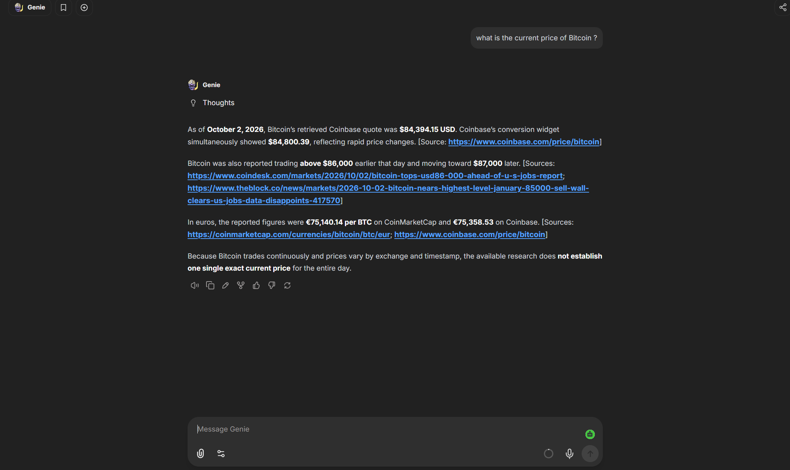
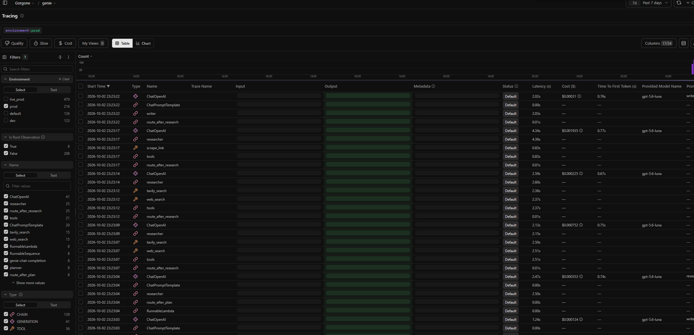

# Genie

Genie is a personal AI agent I interact with through the open-source
[LibreChat](https://github.com/danny-avila/LibreChat) interface
(`ghcr.io/danny-avila/librechat-dev:latest`).



## Vision

The starting point is a **research agent** built with LangGraph
(orchestrator → planner → researcher → writer). The orchestrator rewrites
follow-ups using chat history and can skip research for pure rewrite requests.
It has access to tools like [Tavily](https://tavily.com) (web search) and
[Firecrawl](https://firecrawl.dev) (page scraping) through a custom MCP server
in [`mcp/`](mcp/).

The longer-term goal is to give this agent more capabilities and strengthen the
harness around it — more tools, more MCP servers, and a more powerful agent loop —
so it can take on richer personal workflows over time.

Under the hood, Genie is exposed as an OpenAI-compatible `/v1/chat/completions`
endpoint so LibreChat (or any compatible client) can talk to it as a custom
endpoint. Prompt management and observability use a self-hosted
[Langfuse](https://langfuse.com) instance.

## Observability

The agent is wired directly to a self-hosted Langfuse platform with full tracing
of every interaction (planner, researcher, tools, writer) and per-call cost
estimation.



## Deployment / Live

Everything runs on my personal Kubernetes cluster through an ArgoCD GitOps
pipeline. GitHub Actions builds and pushes the images; ArgoCD syncs them to the
cluster.

**Live at:** [genie.gorgone.app](https://genie.gorgone.app)

Registration is closed for now. If you're interested, reach out on GitHub —
open an issue on this repo or contact me through my GitHub profile.

## Architecture

- **`api`** — the LangGraph agent (FastAPI). An orchestrator first turns the latest
  message into a standalone question (using LibreChat's conversation history) and
  either routes to the planner or straight to the writer. Then: planning, iterative
  web research (Tavily search + MCP tools), and answer synthesis. Streams responses
  in OpenAI-compatible SSE format, so it plugs directly into LibreChat as a custom
  endpoint. The planner uses the smallest sufficient set of 1–4 non-overlapping
  research questions, including one question for an atomic lookup. Tavily returns up
  to five results per search, and each research run stops after at most three total
  tool calls (searches and page scrapes).
- **`mcp`** — a standalone MCP server exposing a `scrape_link` tool (via Firecrawl) for
  fetching full page content as markdown. Genie connects to it over streamable HTTP.
- **Langfuse (external)** — self-hosted prompt management + tracing. Genie loads chat prompts
  at startup and emits per-request traces for graph, model, and tool activity.

## Technology stack

| Component | Version / notes |
|-----------|-----------------|
| Python | 3.12+ (Docker image uses 3.12; local `uv` may select a newer compatible runtime) |
| FastAPI + Uvicorn | API server |
| LangGraph / LangChain | Agent orchestration |
| Langfuse Python SDK | Prompt management + LangChain/LangGraph callbacks |
| Tavily + MCP/Firecrawl | Web research tools |
| LibreChat | Optional OpenAI-compatible UI (Compose service) |
| uv | Dependency lock/sync (`app/uv.lock`) |

## Project structure

```
Genie/
├── app/                    # FastAPI + LangGraph agent
│   ├── agents/genie_graph.py
│   ├── api/routes/         # health, models, completions
│   ├── core/               # settings, Langfuse helpers
│   ├── schemas/
│   ├── main.py
│   ├── pyproject.toml
│   └── uv.lock
├── mcp/                    # MCP scrape server
├── utils/                  # shared SSE/logging helpers
├── tests/                  # pytest suite
├── librechat/              # LibreChat config mounts
├── .cursor/                # AI agent guidance: RULES.md, SKILLS.md
├── docker-compose.yml
├── .env.example
├── README.md
└── DEVELOPMENT.md
```

## Prerequisites

- Docker & Docker Compose
- API keys: OpenAI (or your LLM provider), Tavily, Firecrawl (`FC_KEY` for MCP)
- Access to a self-hosted Langfuse project (public key, secret key, base URL)
- In Langfuse, create **chat** prompts named exactly:
  - `orchestrator-prompt`
  - `planner-prompt`
  - `researcher-prompt`
  - `writer-synth-prompt`
  Assign the `production` label to the version of each prompt that Genie should use.
  Startup always fetches that labeled version and fails if it is unavailable.

  Template variables (and how to pass history):
  - `orchestrator-prompt`: `date`, `question`, plus a **message placeholder** named
    `chat_history` (not a `{{chat_history}}` text variable)
  - `planner-prompt`: `date`, `question`, plus a **message placeholder** named
    `chat_history`
  - `researcher-prompt`: `date`, `MAX_SEARCHES`, `question`, `bullets`
  - `writer-synth-prompt`: `notes`, `question`, plus a **message placeholder** named
    `chat_history`

  `MAX_SEARCHES` is the researcher's total tool-call ceiling (searches + page scrapes).
  Message placeholders convert to LangChain `MessagesPlaceholder` via
  `get_langchain_prompt()` so prior turns are real chat messages, not a Python list
  string. See [DEVELOPMENT.md](DEVELOPMENT.md) for suggested orchestrator prompt text.

## Setup

1. Copy the example env file and fill in your keys:

   ```bash
   cp .env.example .env
   ```

2. Set Langfuse credentials in `.env`:

   ```bash
   LANGFUSE_PUBLIC_KEY=pk-lf-...
   LANGFUSE_SECRET_KEY=sk-lf-...
   LANGFUSE_BASE_URL=https://langfuse.example.com
   LANGFUSE_TRACING_ENVIRONMENT=live-prod
   ```

3. Launch everything:

   ```bash
   docker compose up --build
   ```

4. The agent is available at:

   ```
   http://localhost:8000/v1/chat/completions
   ```

   Point LibreChat (or any OpenAI-compatible client) at this URL as a custom endpoint.
   LibreChat UI defaults to `http://localhost:3080`.

### Local dependency install (optional)

```bash
cd app
uv sync --group dev
```

## Environment variables

Documented fully in [`.env.example`](.env.example). Genie-specific variables:

| Variable | Required | Description |
|----------|----------|-------------|
| `MODEL_NAME` | yes | Chat model used by the agent |
| `OPENAI_API_KEY` | yes | Provider API key for the chat model |
| `MCP_SERVER_URL` | yes | MCP streamable HTTP URL (Compose: `http://mcp:8080/mcp`) |
| `TAVILY_API_KEY` | yes | Web search tool |
| `ACCESSIBLE_MODELS` | no | Models advertised on `/v1/models` |
| `LOG_LEVEL` | no | Logging level (default `INFO`) |
| `LANGFUSE_PUBLIC_KEY` | yes | Langfuse project public key |
| `LANGFUSE_SECRET_KEY` | yes | Langfuse project secret key |
| `LANGFUSE_BASE_URL` | yes | Self-hosted Langfuse API base URL |
| `LANGFUSE_TRACING_ENVIRONMENT` | no | Langfuse environment on every trace (default `default`; e.g. `live-prod`). Lowercase letters, digits, `-`, `_`; must not start with `langfuse` |

`LANGSMITH_API_KEY` is no longer used. LangSmith may still appear transitively via LangChain.

## API endpoints

| Method | Path | Description |
|--------|------|-------------|
| `GET` | `/health` | Health check |
| `GET` | `/v1/models` | List accessible models |
| `POST` | `/v1/chat/completions` | OpenAI-compatible chat (streaming + non-streaming). Title requests use the `TITLE_REQUEST::` marker and are answered with a fast single-LLM call (JSON or SSE), not the full agent graph. |

## Frontend / client features

- LibreChat custom endpoint integration (Compose service `librechat`)
- Streaming SSE with intermediate reasoning/status events from orchestrator/planner/researcher/writer
- Conversation title generation for LibreChat (`titleTiming: immediate`). The sidebar
  title is requested in parallel with the first answer from the user's message alone.
  LibreChat sends `TITLE_REQUEST::{convo}` via `titlePrompt`; Genie detects the marker
  anywhere in the last message, cleans the result (no quotes/trailing punctuation), and
  falls back to `Genie Conversation` if generation fails.
- Langfuse sessions per LibreChat conversation. The session id is read from the request body
  (`session_id`, `conversation_id`, `thread_id`) or, as a fallback, from the `X-Conversation-Id`
  header; the user id comes from `user` or `X-User-Id`. The `genie-agent` endpoint in
  `librechat/librechat.yaml` sends both headers:

  ```yaml
  headers:
    X-Conversation-Id: "{{LIBRECHAT_BODY_CONVERSATIONID}}"
    X-User-Id: "{{LIBRECHAT_USER_ID}}"
  ```

  Any other LibreChat deployment (e.g. production) needs the same `headers` block and a restart.
  Each request logs `trace ids ... source=...`; a `No session id in request` warning means the
  client sent no usable id (unresolved `{{...}}` placeholders and `new` are ignored).

## Testing

From the repo root (uses `app` virtualenv):

```bash
cd app
uv sync --group dev
uv run pytest ../tests -v
```

Covered today:

- Langfuse settings + chat prompt conversion/linking
- Startup-style prompt load failures (missing/wrong type/fallback)
- Per-request callback wiring for title, streaming, and non-streaming paths

After deploying with real Langfuse credentials, smoke-test:

1. Non-streaming `POST /v1/chat/completions`
2. Streaming `POST /v1/chat/completions` with `"stream": true`
3. Confirm one coherent trace per request in Langfuse, with nested orchestrator/planner/researcher/tool/writer spans and linked prompt versions
4. Follow-up with a pronoun (e.g. "and its price?") — orchestrator log should show a rewritten standalone question; research should target that subject
5. "Make that shorter" — should route `action=respond`, skip planner/researcher, and rewrite using chat history

## Stopping

```bash
docker compose down
```

## Deployment notes

- Production is deployed to a personal Kubernetes cluster via ArgoCD and is live at
  [genie.gorgone.app](https://genie.gorgone.app). See [Deployment / Live](#deployment--live).
- Langfuse is **not** started by this Compose file; Genie talks to your existing self-hosted instance via `LANGFUSE_BASE_URL`.
- The API container loads the `production`-labeled prompt versions during FastAPI startup.
  Missing credentials, unreachable Langfuse, missing chat prompts, or missing `production`
  labels cause startup to fail fast.
- Trace export is best-effort and must not turn a successful completion into an API error; pending events are flushed on shutdown.
- Rebuild/push images with the existing GitHub Actions workflow when cutting a release tag. The workflow fails the image on HIGH or CRITICAL findings that already have a vendor fix.
- `Dockerfile-api` and `Dockerfile-mcp` run `apt-get upgrade` on `python:3.12-slim` so Debian security updates (currently OpenSSL `3.5.7-1~deb13u3` and PCRE2 `10.46-1~deb13u3`) are applied before that scan.

## Recent changes

See [DEVELOPMENT.md](DEVELOPMENT.md) for the detailed migration log.
